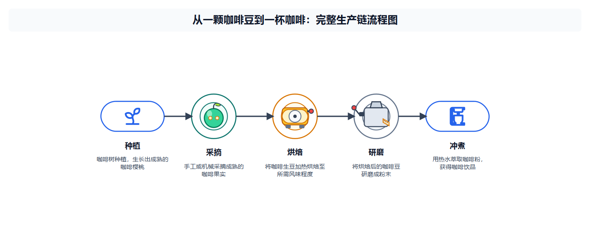
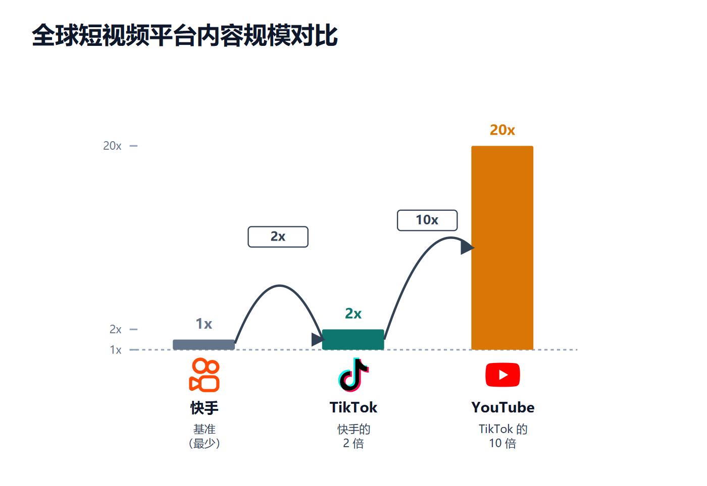
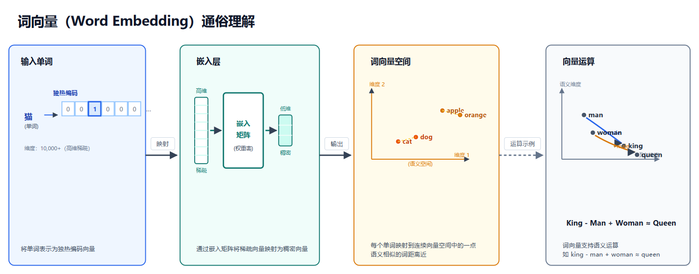

# 多智能体 SVG 信息图生成系统

一句话需求进，一张可以直接用的静态 SVG 信息图出。



> 输入：`绘制 SVG 流程图，展示从一颗咖啡豆到一杯咖啡的完整生产链（种植、采摘、烘焙、研磨、冲煮）`
> 输出：上面这张图。图标、连线、序号、说明文字齐全，无需人工调坐标。

支持四类版式：**流程 / 时间线 / 数据对比 / 概念分解**。

---

## 为什么不直接让大模型写 SVG

试过就知道，让模型一次性输出 SVG 有三个绕不过去的问题：

1. **坐标靠猜。** 模型对"两个框之间留 40px"没有稳定概念，多画几个节点就重叠。
2. **越改越乱。** 第二轮修补经常把第一轮没问题的部分改坏，整张图慢慢漂移。
3. **图标画不出来。** 让模型手写图标路径，出来的东西基本不能用。

这个项目的解法是把**「决定画什么」和「算画在哪」彻底拆开**：

- **LLM 只输出意图**——有哪些节点、什么关系、用什么图标 ID、什么风格。
- **坐标由确定性引擎计算**——布局、避让、连线路由全部是普通 Python 函数，不经过模型。
- **结果可复现**——同样的结构化意图，重跑一次得到同样的布局。

---

## 效果

**数据对比类**：柱子比例、倍数标注、品牌图标自动匹配。



**概念分解类**：多面板拆解，卡片式布局，箭头表示推导关系。



---

## 流水线

```
内容分析 → 图标解析 → 结构规划 → 布局计算 → 样式设计 → SVG 生成 → 图标注入 → 校验
   ▲ LLM        ▲ 代码       ▲ LLM        ▲ 代码      ▲ LLM       ▲ LLM      ▲ 代码     ▲ 代码+LLM
```

8 个阶段里 **5 个由 LLM 参与、3 个是纯确定性代码**。每个阶段的输入输出都是结构化 JSON，阶段之间靠契约而不是自由文本衔接——这也是为什么单个阶段可以被单独替换、单独测试。

---

## 三个关键设计

### 1. 图标：模型只给 ID，路径由代码注入

让模型生成图标路径是灾难。这里让模型只输出 `icon_id` 和 `label`，真实路径在后处理阶段以 `<symbol>` / `<use>` 注入，同时支持品牌色和主题色。

解析链路是五级的，前一级拿不到就降级：

```
local → cache → Iconify search → SimpleIcons → fallback 占位
```

好处有两个：token 消耗大幅下降，以及图标永远不会"画歪"——它要么是真图标，要么是个明确的占位块。

### 2. 重试：模型只输出 diff，不重画整张图

校验失败时，不是让模型重新生成整张 SVG（贵，而且容易把好的部分也改坏），而是**只让它输出 unified diff 补丁**，由本地补丁器校验上下文后应用。

```
patch 校验通过  → 应用
patch 校验失败  → 回退完整重生成
```

绝大多数修复只需要改动几个坐标数字，patch 通常几十个 token 就够。

### 3. 择优：新版本必须比旧版本好，才允许替换

每一轮候选稿都会和历史最佳稿比较：重叠、越界、图标遮挡、槽位偏移，加上 Qwen-VL 的多模态视觉评估。**只有更优才替换，否则回滚。**

配合箭头正交路由和障碍物避让（零碰撞优先），保证多轮迭代不会让图越来越差——这一条是整个系统能稳定出图的前提。

---

## 快速开始

```bash
pip install -r requirements.txt

cp .env.example .env      # 填入 DeepSeek 与 Qwen-VL 的 key
streamlit run app.py
```

浏览器打开后输入需求即可生成。生成的 SVG 与中间产物落在 `output/svg/`。

**先验证模型能力**（可选但推荐）：不同模型对工具调用的支持差别很大，这个脚本会依次验证工具调用、结构化输出、多轮协作三步：

```bash
python verify_agents.py
```

---

## 目录结构

```
agents/              智能体与编排
  orchestrator.py        8 阶段流水线调度、失败重试与回滚
  content_analyzer.py    内容拆解
  structure_planner.py   结构规划
  style_designer.py      样式设计
  code_generator.py      SVG 生成与 patch 修复
  reviewer.py            审查
  icon_resolver.py       图标五级解析
  validator.py           确定性校验
  studio.py / team.py    AutoGen 智能体定义
prompts/             5 份提示词，按阶段拆分
utils/
  layout.py              坐标计算、碰撞检测、正交路由
  svg.py                 SVG 解析与 <symbol>/<use> 注入
  validation.py          重叠 / 越界 / 遮挡 校验
  visual_eval.py         Qwen-VL 视觉评估
  icons.py               图标缓存与品牌色
figures/             生成效果示例
app.py               Streamlit 界面
verify_agents.py     模型能力验证脚本
```

---

## 已知限制

- 布局模板是预置的（流程、对比、时间线、分镜几类），复杂自由布局仍会出现碰撞后降级。
- 依赖模型的内容理解能力，需求越抽象，节点拆解质量波动越大。
- 输出是静态 SVG，没有交互和动画。
- 视觉评估需要多模态模型，纯文本模型下会退化为仅规则校验。

---

## 背景

最初是一门课程的期末项目，用来验证"多智能体协作能不能真的产出一个可用的东西"。之后做了重构：把原来写死在提示词里的坐标逻辑抽成确定性引擎，补上补丁重试、候选择优和 120+ 个单元测试（LLM 全部 mock，所以测试不需要网络）。
